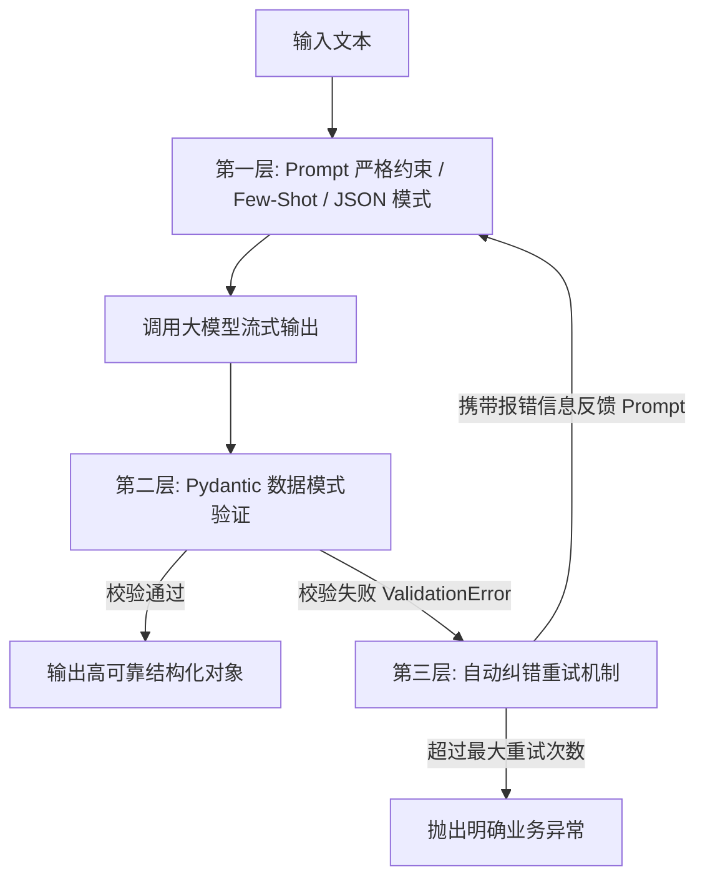

# 架构决策记录 (Architecture Decision Records - ADR)

本文档记录了 `ChatRobot` 项目在架构设计与关键技术选型过程中的权衡与决策，旨在阐明“为什么这样设计”以及背后的考量。

---

## 决策 1：为什么流式输出选择 SSE 而不是 WebSocket？

### 背景
LLM（大语言模型）的生成是逐 token 生成的，为了提供类似“打字机”的流畅交互体验，降低首字延迟（TTFT, Time to First Token），服务端需要将流式内容持续推送到客户端。

### 备选方案
- **WebSocket**：全双工双向通信协议，建立在 TCP 之上，需要经过一次 HTTP 握手并升级（Upgrade）。
- **SSE (Server-Sent Events, 服务端发送事件)**：基于标准 HTTP/1.1 或 HTTP/2 的单向推送机制，文本协议。
- **轮询 (Short/Long Polling)**：客户端频繁发起 HTTP 请求拉取新内容。

### 决策与权衡
我们最终选择了 **SSE (`text/event-stream`)**。

#### 核心理由：
1. **单向契约契合**：用户发问是一次性完成的，大模型的推理输出则是单向连续流式下发，根本不需要双向同时传输。
2. **轻量与协议兼容**：SSE 完全基于标准 HTTP 协议，对现有的 API 网关、Nginx 反向代理、负载均衡器及身份认证拦截器（如 JWT Bearer）零侵入，直接支持。而 WebSocket 需要专门配置连接升级与代理超时。
3. **原生重连与事件支持**：浏览器端拥有原生的 `EventSource` 支持，自带断线自动重连能力与事件流分割解析机制。
4. **资源占用更低**：相比维持全双工长连接的 WebSocket 握手开销与状态管理，SSE 的实现更精简，在无状态微服务集群中更容易弹性伸缩。

---

## 决策 2：为什么多 Provider 采用“抽象基类 + 工厂模式”？

### 背景
项目需要同时对接多家不同的大模型提供商（如 DeepSeek、阿里通义千问 Qwen、甚至后续的 OpenAI / 本地 Ollama），不同平台的接口地址、鉴权方式及返回的数据格式各异。

### 备选方案
- **方案 A（过程式 if/else）**：在路由处理函数中通过 `if/else` 分支直接拼装各厂商的请求并解析。
- **方案 B（抽象基类 ABC + 工厂模式 Factory）**：定义标准的 Provider 抽象基类，各供应商继承并实现统一接口，由工厂函数统一负责实例化。

### 决策与权衡
我们最终选择了 **方案 B：抽象基类 (`LLMProvider`) + 工厂模式 (`get_provider`)**。

#### 核心理由：
1. **符合“开闭原则”（OCP）**：
   - 对扩展开放：当需要接入新的模型平台（如智谱 GLM、Claude）时，只需在 `app/providers/` 下新建一个文件继承 `LLMProvider`，并在工厂中注册即可。
   - 对修改关闭：`app/main.py` 及上层业务逻辑代码一行都不用改动。
2. **统一契约与强类型提示**：
   - 通过 Python `abc.abstractmethod` 强制派生类实现 `chat(messages)` 与 `stream_chat(messages)`。
   - 保证了不论底层使用何种厂商的 API，上层调用的签名、入参格式、返回结构全部一致。
3. **环境与配置解耦**：
   - 工厂函数支持通过读取 `.env` 中的 `LLM_PROVIDER` 环境变量实现全局零改动热切换，极大方便了本地开发、测试与生产环境的灵活配置。

---

## 决策 3：为什么多轮对话历史由客户端传递？

### 背景
LLM 本身是没有记忆的，要实现多轮上下文对话（Multi-turn Conversation），必须在每次向大模型发送请求时，携带前几轮的对话历史（Messages List）。

### 备选方案
- **服务端 Session/DB 维护**：服务端为每个会话分配会话 ID，将历史消息保存在服务器内存或数据库（如 Redis/SQLite）中。
- **客户端传递（Client-managed Context）**：客户端本地保存消息历史，在每次调用 `/chat` 或 `/chat/stream` 时，将完整的 `history` 数组随请求一同提交。

### 决策与权衡
在当前阶段，我们选择了 **客户端传递（服务端保持无状态 Stateless）**。

#### 核心理由：
1. **服务端完全无状态（Stateless）**：
   - 服务端节点无需维护用户状态或内存会话表，可以随意横向扩展（水平扩容）、挂载负载均衡。
   - 彻底避免了单点故障、Session 粘滞（Session Stickiness）与分布式锁的复杂度。
2. **RESTful 规范**：每个 HTTP 请求都包含了完成本次调用所需的全部上下文信息。
3. **灵活性**：客户端可以自由决定携带的历史轮数、剪裁滑动窗口策略，或者清空对话，而不需要服务端提供复杂的会话状态重置接口。

#### 权衡与演进计划：
- *代价*：请求体随着对话轮数增加会逐步变大；刷新浏览器或跨端登录时历史记录无法自动同步。
- *后续演进（阶段五规划）*：增加持久化数据库（SQLite/PostgreSQL）及 `/conversations` 会话管理接口，实现“轻量无状态路由”与“集中持久化存储”的双层解耦。

---

## 决策 4：结构化输出与容错机制（三层防护策略）

### 背景
大模型生成的自然语言具有不确定性，而在做简历解析、情感判断或信息提取时，下游系统需要严格确定性的 JSON 结构。

### 架构设计：三层防御网
在 `scripts/analyze_resume.py` 中，我们设计了三层防御机制保障可靠输出：

1. **第一层：输入约束**：通过 System Prompt 角色设定、Few-shot 少量示例、思维链（CoT）以及 API 层的 `response_format={"type": "json_object"}`，在源头降低格式走偏的概率。
2. **第二层：强类型模式校验**：使用 `Pydantic` 进行运行时数据类型检验与字段完整性断言。
3. **第三层：反馈重试（Self-Correction）**：捕获 `ValidationError`，提取具体的字段错误原因组装为 Feedback 注入下一轮 Prompt，让模型“看着错误原因自己修正”，极大提高了成功率。
